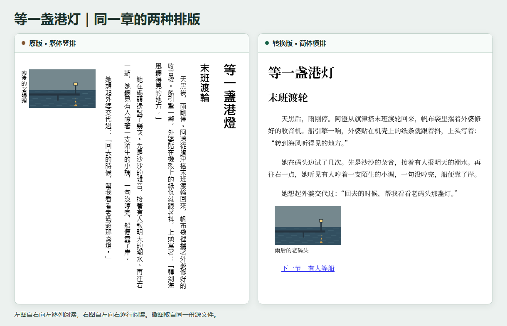

# 电子书简体横排

把台湾繁体电子书变成适合从左到右阅读的简体横排版。可以在 Codex 里作为 Skill 使用，也可以直接在本机命令行运行。

默认保留台湾文学里的用词和语气。例如「滑鼠」会变成“滑鼠”，开启大陆词汇选项后才会变成“鼠标”。正文、目录和可编辑的书名会转为简体，封面与插图保留原图，图中嵌入的繁体字随原图保留。

## 网页版

[纸间 · EPUB 在线转换](https://ebook.niannu.icu/)在浏览器内完成转换。网页支持 50 MB 以内的可重排 EPUB，提供原创样书供试用。AZW3、MOBI 和 PDF 可使用下面的命令行工具处理。

本地开发需要 Node.js 22.12+ 或 24+。

```bash
cd web
npm ci
npm run dev
```

## 下载与对照

**原创样书《等一盏港灯》**演示竖排到横排的变化。可以下载两份 EPUB，在自己的阅读器里比较。

[繁体竖排 EPUB](examples/demo-zh-tw.epub) · [简体横排 EPUB](examples/demo-zh-cn.epub)



## 支持的格式

| 格式 | 读入 | 输出 |
| --- | --- | --- |
| EPUB | 直接读取可重排的 EPUB 2 / 3 | 默认格式，保留章节顺序、目录链接和图片 |
| AZW3 / MOBI | 通过 Calibre 转为中间 EPUB | 通过 Calibre 输出，部分样式和字体可能随格式变化 |
| PDF | 通过 Calibre 提取文字层 | 由横排内容重新分页，可指定已安装的中文字体 |

扫描图像型 PDF 需要先做 OCR。直排、多栏和带注释的 PDF 即使能选中文字，也可能抽取出错序的段落，建议用原版 EPUB 转换。固定版式 EPUB 需要另行重排。受 DRM 保护的电子书需要已有可转换版本。

## 命令行用法

需要 Python 3.10 或更新版本。Windows 上也可把示例里的 `python` 换成 `py`。

```bash
git clone https://github.com/417kkai/ebook-hengpai.git
cd ebook-hengpai
python -m pip install -r ebook-hengpai/scripts/requirements.txt
python ebook-hengpai/scripts/convert.py "繁体小说.epub"
```

默认在输入文件旁生成 `繁体小说（简体横排）.epub`。已有同名文件时，用 `-o` 指定一个新文件名。

```bash
python ebook-hengpai/scripts/convert.py "繁体小说.epub" -o "简体版.epub" --keep-quotes
python ebook-hengpai/scripts/convert.py "繁体小说.azw3" -o "简体版.epub"
python ebook-hengpai/scripts/convert.py "繁体小说.epub" -o "简体版.mobi"
python ebook-hengpai/scripts/convert.py "繁体小说.epub" -o "简体版.pdf" --pdf-font "Noto Serif CJK SC"
```

EPUB 直转只用 Python 依赖。涉及 PDF、AZW3 或 MOBI 时，安装 [Calibre](https://calibre-ebook.com/download)，让工具能找到 `ebook-convert`，或通过 `--calibre` 传入其完整路径。PDF 导出示例中的字体需要先安装，也可以换成电脑已有的简体中文字体。

- `--keep-quotes` 保留「」和『』。
- `--mainland-terms` 使用 OpenCC 的大陆常用词汇表。文学作品默认关闭此项。
- `--json` 输出机器可读的转换结果。
- `--help` 查看全部参数。

转换在本机完成。输入文件始终保留。

## 在 Codex 中使用

把项目里的整个 `ebook-hengpai/` Skill 目录复制到个人技能目录 `~/.agents/skills/`。最终路径应为 `~/.agents/skills/ebook-hengpai/SKILL.md`。按需重新打开 Codex，随后附上文件并输入：

> 用 $ebook-hengpai 把这本台湾繁体 EPUB 转成简体横排 EPUB，保留台式用词。

## 开发与测试

```bash
python -m unittest discover -s tests -v
```

测试用自制书验证章节顺序、目录、简繁转换、横排、图片和原文件保护。转换使用 [OpenCC](https://github.com/BYVoid/OpenCC)，跨格式工作流基于 [Calibre](https://manual.calibre-ebook.com/zh_Hans/conversion.html)。

代码采用 [MIT 许可证](LICENSE)。
